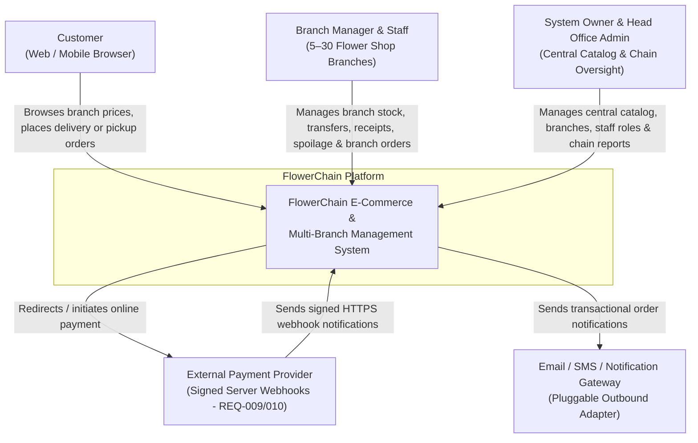
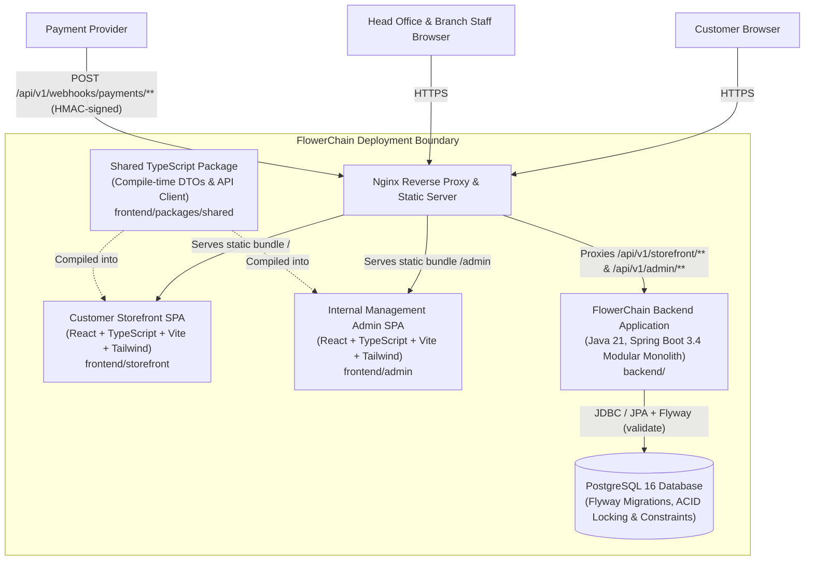
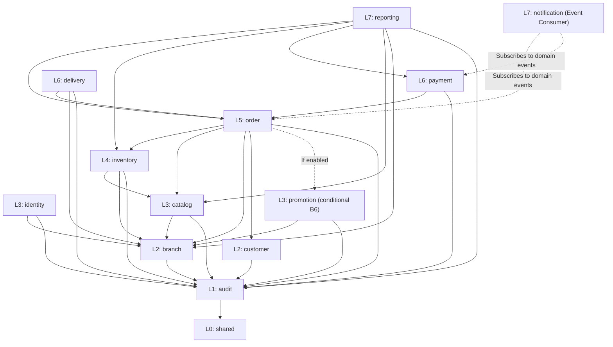
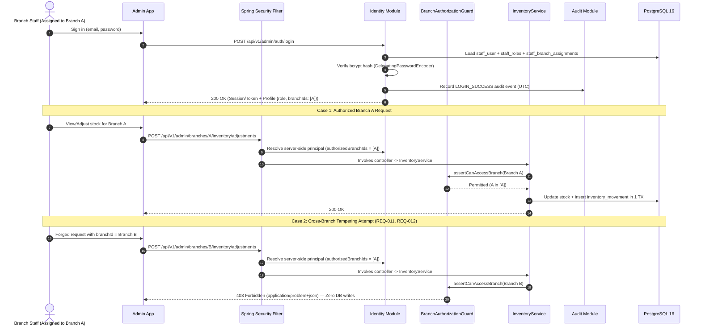
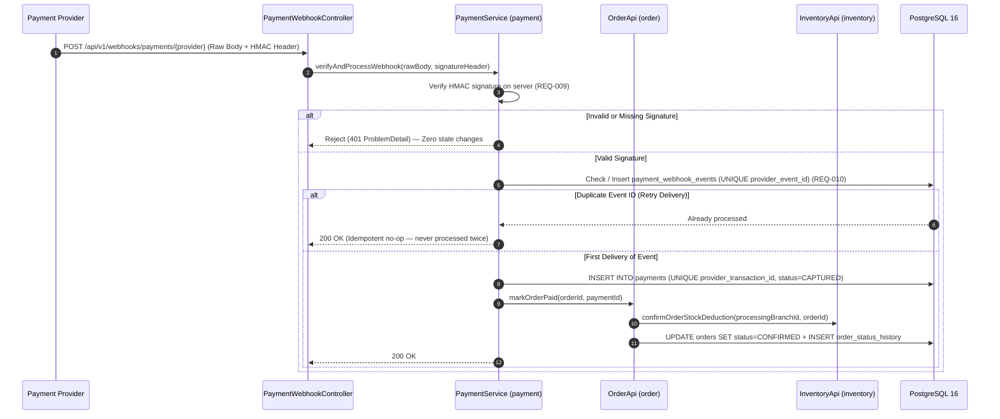
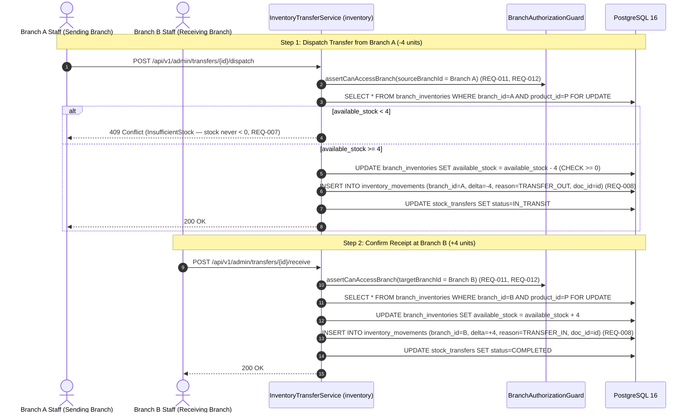

# Architecture Diagrams (C4, Module Dependency, Deployment, and Runtime Flows)

- **Status:** PROPOSED (awaiting owner approval at Phase 4 gate before P06)
- **Last updated:** 2026-11-24
- **Owner:** solution-architect · **Task:** TASK-011 (Phase 4 — P05 Solution Architecture)
- **Sources:** `ADR-0001`, `module-map.md`, `cross-cutting-and-security.md`, P04 `functional-requirements.md`.

---

## 1. System Context Diagram (C4 Level 1)



---

## 2. Container Diagram (C4 Level 2)



---

## 3. Backend Component Diagram (C4 Level 3 — Modular Monolith Internals)

```mermaid
flowchart TB
    subgraph WebLayer["HTTP / Security Perimeter (Spring Security Deny-by-Default)"]
        SecFilter["Security & BranchPrincipal Filter"]
        IdemFilter["Idempotency-Key Filter"]
        ErrHandler["RFC 9457 ProblemDetails Exception Handler"]
        StorefrontApis["Storefront Controllers<br/>(/api/v1/storefront/**)"]
        AdminApis["Admin Controllers<br/>(/api/v1/admin/**)"]
        WebhookApis["Payment Webhook Controller<br/>(/api/v1/webhooks/payments/**)"]
    end

    subgraph SharedKernel["Shared Technical Kernel (com.flowerchain.shared)"]
        BranchGuard["BranchAuthorizationGuard<br/>(REQ-011 / REQ-012)"]
    end

    subgraph BusinessModules["Spring Modulith Business Modules (com.flowerchain.*)"]
        IdentityMod["identity<br/>(Staff, RBAC, Branch Scope)"]
        BranchMod["branch<br/>(5–30 Branches, Zones, Settings)"]
        CustomerMod["customer<br/>(Profiles, Addresses)"]
        CatalogMod["catalog<br/>(Central SKUs, Branch Prices)"]
        InventoryMod["inventory<br/>(Branch Stock, Audit Ledger, Transfers, Receipts, Spoilage)"]
        OrderMod["order<br/>(Allocation, Snapshots, Status Lifecycle)"]
        DeliveryMod["delivery<br/>(Delivery Dispatch & Pickup Hand-over)"]
        PaymentMod["payment<br/>(Webhook Verification, Idempotency, Refunds)"]
        NotificationMod["notification<br/>(Event Listeners & Alerts)"]
        ReportingMod["reporting<br/>(Read-Only Aggregations)"]
        AuditMod["audit<br/>(Immutable Security/Price/Order/Refund Logs)"]
    end

    SecFilter --> StorefrontApis
    SecFilter --> AdminApis
    WebhookApis --> PaymentMod
    StorefrontApis --> OrderMod
    StorefrontApis --> CatalogMod
    StorefrontApis --> BranchMod
    StorefrontApis --> CustomerMod
    AdminApis --> BranchGuard
    BranchGuard --> IdentityMod
    BranchGuard --> BranchMod
    BranchGuard --> CatalogMod
    BranchGuard --> InventoryMod
    BranchGuard --> OrderMod
    BranchGuard --> DeliveryMod
    BranchGuard --> PaymentMod
    BranchGuard --> ReportingMod
    BranchGuard --> AuditMod
```



---

## 4. Module Dependency Diagram (Acyclic Topological DAG)

Arrows point from a dependent module to the module's public `.api` package it calls (`A --> B` means `A` calls `B.api`).



---

## 5. Deployment & CI/CD Diagram (`DEC-007`, `DEC-015`)

```mermaid
flowchart LR
    subgraph DevEnv["Developer Workstation (No Local Docker - DEC-015)"]
        DevCode["Git Working Tree<br/>JDK 21 + Node.js LTS (DEC-014)"]
        UnitTests["Local Fast Feedback:<br/>• ./mvnw test (JUnit 5, Mockito, ArchUnit/Modulith)<br/>• npm run build & vitest"]
    end

    subgraph GitHubActions["GitHub Actions CI/CD (Linux Runner with Docker)"]
        CIBuild["1. Build & Format Check"]
        CITestcontainers["2. Integration Tests:<br/>Testcontainers PostgreSQL 16<br/>(Flyway migrations, Concurrency REQ-007,<br/>Audit REQ-008, Webhooks REQ-009/010,<br/>Branch Auth REQ-011/012)"]
        CIPlaywright["3. Playwright E2E Suite"]
        CIDockerBuild["4. Multi-Stage Docker Image Build<br/>(backend, storefront, admin)"]
    end

    subgraph RuntimeEnv["Staging / Production Environment (Approval Gate)"]
        NginxProxy["Nginx Container<br/>(TLS, Static SPAs, /api/v1 Proxy)"]
        SpringContainer["Spring Boot 3.4 Container<br/>(Non-root JVM 21)"]
        ManagedPostgres[("PostgreSQL 16<br/>(Automated Backups & WAL)")]
    end

    DevCode --> UnitTests
    UnitTests -->|"git push (with owner approval)"| CIBuild
    CIBuild --> CITestcontainers
    CITestcontainers --> CIPlaywright
    CIPlaywright --> CIDockerBuild
    CIDockerBuild -->|"Explicit Owner Deployment Approval"| NginxProxy
    NginxProxy --> SpringContainer
    SpringContainer --> ManagedPostgres
```



---

## 6. Runtime Flow 1: Authentication and Branch-Scoped Authorization Flow (`REQ-011`, `REQ-012`)



---

## 7. Runtime Flow 2: Online Order Placement, Nearest-Branch Allocation & Snapshot Flow (`REQ-005`..`008`, `REQ-013`, `REQ-014`)

```mermaid
sequenceDiagram
    autonumber
    actor Cust as Customer
    participant StoreUI as Storefront App
    participant OrderSvc as OrderService (order)
    participant BranchApi as BranchApi (branch)
    participant InvApi as InventoryApi (inventory)
    participant CatApi as CatalogApi (catalog)
    participant DB as PostgreSQL 16

    Cust->>StoreUI: Submit Delivery Order (Address, Items, Idempotency-Key)
    StoreUI->>OrderSvc: POST /api/v1/storefront/orders (ignores any client branchId - REQ-012)
    activate OrderSvc
    Note over OrderSvc,DB: Single ACID @Transactional Boundary
    OrderSvc->>BranchApi: findBranchesCoveringLocation(deliveryLat, deliveryLng)
    BranchApi-->>OrderSvc: Candidate branches ordered by distance [Branch A (2km), Branch B (4.5km)]
    OrderSvc->>InvApi: findFirstBranchWithSufficientStock([A, B], itemQuantities)
    Note over InvApi,DB: Branch A lacks stock for SKU-2; Branch B has full stock
    InvApi-->>OrderSvc: Selected processingBranchId = Branch B (REQ-005, REQ-014)
    OrderSvc->>CatApi: getProductSnapshotsForBranch(Branch B, productIds)
    CatApi-->>OrderSvc: Snapshots [{sku, productName, unitPriceAtBranchB}] (REQ-004, REQ-006)
    OrderSvc->>InvApi: reserveStockForOrder(Branch B, orderId, itemQuantities)
    InvApi->>DB: SELECT ... FROM branch_inventories WHERE branch_id=B FOR UPDATE (sorted SKUs)
    InvApi->>DB: Verify available_stock >= qty (REQ-007) & decrement available_stock
    InvApi->>DB: INSERT INTO inventory_movements (-qty, ORDER_RESERVED, branch_id=B) (REQ-008)
    OrderSvc->>DB: INSERT INTO orders (processing_branch_id=B, status=PENDING_PAYMENT)
    OrderSvc->>DB: INSERT INTO order_lines (product_name_snapshot, sku_snapshot, unit_price_snapshot) (REQ-006)
    OrderSvc->>DB: INSERT INTO order_status_history
    OrderSvc-->>StoreUI: 201 Created (orderId, processingBranch=B, snapshottedTotal)
    deactivate OrderSvc
```

---

## 8. Runtime Flow 3: Server-Side Payment Webhook Verification & Idempotency Flow (`REQ-009`, `REQ-010`)



---

## 9. Runtime Flow 4: Inventory Mutation, Concurrency Locking & Inter-Branch Transfer Flow (`REQ-007`, `REQ-008`, `REQ-015`)


