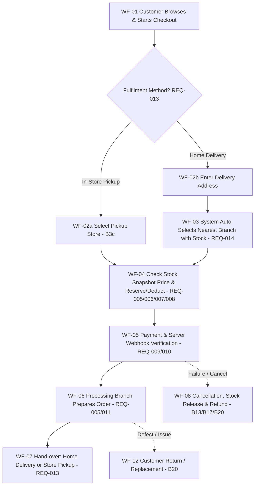

# Business Process Maps (Workflows WF-01 to WF-12)

- **Status:** DRAFT
- **Last updated:** 2026-11-24
- **Owner:** business-analyst · **Task:** TASK-006 (Phase 2 — P03 Business Analysis)
- **Sources:** Owner Brief (2026-11-23), Owner Phase 2 Answers (`B2`, `B3a`, `B3b`, `B9`, 2026-11-23), `CLAUDE.md` §2, §6, §8.
- **Labels:** `CONFIRMED` · `INFERRED` · `PROPOSED` · `NEEDS CONFIRMATION`

This document maps the 12 core business workflows for FlowerChain. Detailed narrative versions of online order fulfilment and inter-branch stock transfers also remain in [processes/online-order-fulfilment.md](processes/online-order-fulfilment.md), [processes/stock-transfer.md](processes/stock-transfer.md), and [processes/walk-in-sale-scope.md](processes/walk-in-sale-scope.md).

---

## End-to-End Order & Inventory Lifecycle Overview

---

## WF-01: Customer Purchase (Browsing, Cart, and Checkout Initiation)

- **Actors:** Customer (`CONFIRMED`), Storefront System (`CONFIRMED`).
- **Trigger:** Customer visits the FlowerChain online storefront to buy flowers (`CONFIRMED`).
- **Preconditions:**
  - Central product catalog contains active products (`REQ-003`, `CONFIRMED`).
  - Branches have configured branch prices (`REQ-004`, `B9`, `CONFIRMED`).
- **Main Flow:**
  1. Customer browses product categories and product detail pages on the storefront (`INFERRED`).
  2. Storefront displays product prices for a branch (`CONFIRMED` per `B9` that prices are per-branch; **which branch's price is shown before checkout is `NEEDS CONFIRMATION` under `B11`**).
  3. Customer adds one or more products with desired quantities to their shopping cart and proceeds to checkout (`INFERRED`).
  4. Customer selects the fulfilment method: **Home Delivery** or **In-Store Pickup** (`CONFIRMED`, `REQ-013`, `B3a`).
  5. Customer provides recipient contact details and proceeds to branch selection/allocation (`INFERRED`).
- **Alternatives:**
  - *A1 (Guest vs. Logged-in Customer):* Customer checks out as a logged-in account holder or guest (`NEEDS CONFIRMATION`, `B6`).
  - *A2 (Apply Promotion/Voucher):* Customer enters a promo/voucher code at checkout (`NEEDS CONFIRMATION`, `B6`).
- **Exceptions:**
  - *E1 (Product has no price at branch):* Branch has not set a price for a central catalog product (`NEEDS CONFIRMATION`, `B9b`, `B10`).
- **Outcomes:** Checkout session is ready for branch selection (`WF-02`) and order allocation (`WF-03`).

---

## WF-02: Branch Selection (Delivery vs. In-Store Pickup)

- **Actors:** Customer (`CONFIRMED`), Backend System (`CONFIRMED`).
- **Trigger:** Customer selects **Home Delivery** or **In-Store Pickup** during checkout (`REQ-013`, `CONFIRMED`).
- **Preconditions:** Cart contains valid products and quantities (`INFERRED`).
- **Main Flow:**
  - **Path A — Home Delivery (`CONFIRMED`, `REQ-014`, `B3b`):**
    1. Customer enters the delivery address (and requested delivery date/time if supported — `NEEDS CONFIRMATION`, `B15`).
    2. Customer does **not** manually pick the fulfilling branch; the system determines the eligible branch automatically (`CONFIRMED`, `B3b`).
    3. Any `branchId` tampered with or sent by the client in a delivery order request is ignored/overridden by the server rule (`CONFIRMED`, `REQ-012`, `REQ-014`).
  - **Path B — In-Store Pickup (`NEEDS CONFIRMATION`, `B3c`):**
    1. A pickup branch is selected (whether the customer chooses the pickup store from branches with stock is `NEEDS CONFIRMATION` under `B3c`).
    2. The selected pickup store is recorded on the order (`INFERRED`; whether the pickup store is always the processing branch is `NEEDS CONFIRMATION` under `B3c`).
- **Alternatives:**
  - *A1 (Branch price difference on selection):* If the selected/assigned branch has a different price than the browsing branch (`B11`), the system either locks the displayed price or prompts the customer to confirm the updated branch price (`NEEDS CONFIRMATION`, `B11`).
- **Exceptions:**
  - *E1 (Address outside delivery area):* Delivery address exceeds the maximum delivery distance/zone of all branches (`NEEDS CONFIRMATION`, `B3e`).
- **Outcomes:** Candidate branch (for pickup) or delivery coordinates/zone (for automatic allocation in `WF-03`) are established.

---

## WF-03: Order Allocation (Automatic Branch Assignment & Exception Handling)

- **Actors:** Backend System (`CONFIRMED`), Head Office / Authorized Staff for manual exception reassignment (`NEEDS CONFIRMATION`, `B14`).
- **Trigger:** Customer submits a delivery order (or pickup order requiring branch assignment) (`CONFIRMED`, `REQ-005`, `REQ-014`).
- **Preconditions:** Delivery address (or pickup store) and requested line items/quantities are validated (`INFERRED`).
- **Main Flow (`CONFIRMED`, `REQ-005`, `REQ-014`, `B3b`):**
  1. System identifies all active branches that currently hold sufficient available stock for every item in the order.
  2. System ranks candidate branches by proximity to the delivery address (how "nearest" is measured — road distance, straight-line, or district/zone — is `NEEDS CONFIRMATION` under `B3e`).
  3. System selects the nearest branch with sufficient stock and assigns it as the order's traceable `processingBranchId` (`CONFIRMED`, `REQ-005`, `REQ-014`).
  4. Order snapshots the product name, SKU, and unit price at order time (`CONFIRMED`, `REQ-006`; which branch's price is snapshotted if browsing branch != assigned branch is `NEEDS CONFIRMATION` under `B11`).
- **Alternatives:**
  - *A1 (Equidistant branches):* If two branches are equally near and both have stock, system applies a deterministic tie-breaker (e.g., higher stock level or lower branch ID — `NEEDS CONFIRMATION`, `B3e`).
  - *A2 (Post-allocation reassignment):* If the assigned branch later cannot fulfil the order, an authorized role reassigns the order to another branch with a recorded reason (`NEEDS CONFIRMATION`, `B14`).
- **Exceptions:**
  - *E1 (No single branch has enough stock for all items):* System either refuses the order, suggests available quantities, transfers stock first, or splits the order across branches (`NEEDS CONFIRMATION`, `B3d`).
  - *E2 (No branch has the item in stock):* System rejects order placement with an out-of-stock Problem Details response (`INFERRED` from `REQ-007`).
- **Outcomes:** Order is persisted with a traceable `processingBranchId` (`REQ-005`) and immutable line item price/product snapshots (`REQ-006`).

---

## WF-04: Inventory Availability and Reservation

- **Actors:** Backend Inventory Module (`CONFIRMED`).
- **Trigger:** Order allocation (`WF-03`) attempts to secure stock at the processing branch (`CONFIRMED`, `REQ-007`, `REQ-008`).
- **Preconditions:** Product stock record exists for the selected `branchId` (`REQ-002`, `CONFIRMED`).
- **Main Flow:**
  1. System acquires a database lock (pessimistic row lock or optimistic version check) on the branch inventory rows for the ordered items (`CONFIRMED`, `CLAUDE.md` §6).
  2. System verifies that `available_stock >= requested_quantity` for every item at the processing branch (`CONFIRMED`, `REQ-007`).
  3. System reserves or deducts the requested quantity so that `available_stock` never falls below zero (`CONFIRMED`, `REQ-007`; exact timing — at order placement vs. payment confirmation — is `NEEDS CONFIRMATION` under `B13`).
  4. System writes an immutable inventory audit record (`REQ-008`: actor/system, UTC timestamp, reason/event type, `branch_id`, quantity delta, and `order_id` reference) (`CONFIRMED`, `REQ-008`).
- **Alternatives:**
  - *A1 (Two-step Reservation → Deduction):* Stock moves from `available` to `reserved` at checkout, and is permanently deducted upon payment confirmation or released on payment timeout/cancellation (`PROPOSED` / `NEEDS CONFIRMATION`, `B13`).
- **Exceptions:**
  - *E1 (Concurrent checkout for the last unit):* Two requests attempt to claim the last units simultaneously. The lock serializes the updates: the first succeeds, and the second either re-allocates to the next nearest branch with stock or fails cleanly without driving stock below zero (`CONFIRMED` non-negative guarantee `REQ-007`; fallback behavior `NEEDS CONFIRMATION` under `B13`).
- **Outcomes:** Branch available inventory is decremented safely (`>= 0`) and an audit log entry is committed in the same transaction (`REQ-007`, `REQ-008`).

---

## WF-05: Payment and Server-Side Webhook Verification

- **Actors:** Customer (`CONFIRMED`), Payment Provider (`CONFIRMED`), Backend Payment Module (`CONFIRMED`).
- **Trigger:** Customer initiates payment for an order, or Payment Provider sends an asynchronous webhook notification (`CONFIRMED`, `REQ-009`, `REQ-010`).
- **Preconditions:** Order exists and is awaiting payment (`INFERRED`).
- **Main Flow:**
  1. Customer is directed to pay using the chosen payment method (`NEEDS CONFIRMATION` which providers/methods are supported under `B4`).
  2. Payment provider sends a webhook callback to the backend server (`CONFIRMED`, `REQ-009`).
  3. Backend verifies the webhook's cryptographic signature/authenticity using the provider's documented server-side verification method **before** executing any business logic (`CONFIRMED`, `REQ-009`, `CLAUDE.md` §8).
  4. Backend checks whether the provider event ID / transaction ID has already been processed (enforced by a database `UNIQUE` constraint and idempotent handler) (`CONFIRMED`, `REQ-010`, `CLAUDE.md` §6, §8).
  5. If valid and unseen, backend records the payment transaction, transitions the order's payment status to paid, writes an audit entry, and notifies the processing branch (`CONFIRMED` rules `REQ-009`, `REQ-010`; exact status name `NEEDS CONFIRMATION`, `B17`).
- **Alternatives:**
  - *A1 (Browser redirect return):* Customer's browser returns to the storefront after payment. The backend **never** treats the browser redirect as proof of payment; it queries the server-verified payment state (`CONFIRMED`, `CLAUDE.md` §8).
  - *A2 (Cash on Delivery / Pay at Store):* If COD or in-store payment is supported (`B4`), staff record payment collection upon hand-over (`NEEDS CONFIRMATION`, `B4`).
- **Exceptions:**
  - *E1 (Invalid or missing webhook signature):* Backend rejects the request (`400`/`401`), logs a security warning without leaking secrets, and performs zero state changes (`CONFIRMED`, `REQ-009`).
  - *E2 (Duplicate webhook delivery):* Provider sends the same webhook event twice. Backend detects the existing event ID, makes no duplicate state/stock/payment change, and returns an idempotent acknowledgement (`CONFIRMED`, `REQ-010`).
  - *E3 (Payment failure or timeout):* Payment is declined or expires; order and reserved stock follow the timeout/cancellation rules (`NEEDS CONFIRMATION`, `B13`, `B17`).
- **Outcomes:** Payment is verified once on the server (`REQ-009`, `REQ-010`), and the order is ready for branch preparation (`WF-06`).

---

## WF-06: Order Fulfillment (Branch Preparation)

- **Actors:** Processing Branch Staff / Branch Manager (`CONFIRMED` branch scope `REQ-005`, `REQ-011`; exact role `NEEDS CONFIRMATION`, `B5`).
- **Trigger:** Order becomes eligible for preparation at its assigned `processingBranchId` (`CONFIRMED`, `REQ-005`).
- **Preconditions:**
  - Staff member is authenticated and authorized for the order's `processingBranchId` (`CONFIRMED`, `REQ-011`, `REQ-012`).
  - Order is assigned to that branch (`CONFIRMED`, `REQ-005`).
- **Main Flow:**
  1. Branch staff view the incoming order queue in the Admin App; the backend filters the query strictly by the authenticated user's authorized branch(es) (`CONFIRMED`, `REQ-011`, `REQ-012`).
  2. Branch staff accept/start preparing the floral arrangement according to the order's snapshotted items (`INFERRED`; status names `NEEDS CONFIRMATION`, `B17`).
  3. Staff mark the order as prepared / ready for delivery or ready for pickup (`INFERRED`; status names `NEEDS CONFIRMATION`, `B17`).
  4. Every order status transition is recorded in the order status audit trail with actor and UTC timestamp (`CONFIRMED`, `CLAUDE.md` §8).
- **Alternatives:**
  - *A1 (Branch cannot fulfil after assignment):* Branch escalates to reassign the order to another branch (`NEEDS CONFIRMATION`, `B14`).
- **Exceptions:**
  - *E1 (Cross-branch access attempt):* Staff from Branch A attempt to view or update an order belonging to Branch B (even by sending Branch B's `branchId` or `orderId`). The backend rejects the request (`403`/`404`) (`CONFIRMED`, `REQ-011`, `REQ-012`).
- **Outcomes:** Order is prepared and ready for customer hand-over (`WF-07`).

---

## WF-07: Delivery or In-Store Pickup Hand-Over

- **Actors:** Processing Branch Staff, Delivery Rider/Courier, Customer (`CONFIRMED` methods `REQ-013`; delivery actor `NEEDS CONFIRMATION`, `B15`).
- **Trigger:** Prepared order (`WF-06`) is ready to be delivered or collected (`CONFIRMED`, `REQ-013`).
- **Preconditions:** Order is in a "ready" state at the processing branch (`INFERRED`).
- **Main Flow:**
  - **Path A — Home Delivery (`CONFIRMED`, `REQ-013`):**
    1. Order is dispatched from the processing branch to the customer's delivery address (`INFERRED`; whether delivered by branch staff or courier is `NEEDS CONFIRMATION` under `B15`).
    2. Upon delivery to the recipient, the order status is updated to delivered/completed and audited (`CLAUDE.md` §8; exact status names `NEEDS CONFIRMATION`, `B17`).
  - **Path B — In-Store Pickup (`CONFIRMED`, `REQ-013`):**
    1. Customer arrives at the pickup branch (`CONFIRMED`, `B3a`).
    2. Branch staff verify the order and hand over the flowers to the customer (`INFERRED`).
    3. Branch staff update the order status to collected/completed, recorded in the audit trail (`CLAUDE.md` §8; status names `NEEDS CONFIRMATION`, `B17`).
- **Exceptions:**
  - *E1 (Recipient unavailable / failed delivery / uncollected pickup):* Flowers are perishable; handling of failed delivery attempts or uncollected pickup orders is `NEEDS CONFIRMATION` under `B15` / `B17`.
- **Outcomes:** Customer receives the order; order reaches its terminal completed state.

---

## WF-08: Order Cancellation and Refund

- **Actors:** Customer, Branch Staff / Manager, Head Office (`NEEDS CONFIRMATION` who can cancel/refund and until which status under `B17`, `B20`).
- **Trigger:** Customer or authorized staff request to cancel an order before completion, or a refund is approved (`CLAUDE.md` §8, `B17`).
- **Preconditions:** Order is in a cancellable/refundable state (`NEEDS CONFIRMATION`, `B17`).
- **Main Flow:**
  1. Actor submits a cancellation request with a reason (`INFERRED`).
  2. Backend checks authorization (customer owns the order, or staff is authorized for the branch/role) and verifies whether the current order status permits cancellation (`CONFIRMED` auth rules `CLAUDE.md` §8; cutoff status `NEEDS CONFIRMATION`, `B17`).
  3. Order status transitions to cancelled and is written to the order status audit trail (`CONFIRMED`, `CLAUDE.md` §8).
  4. If stock was reserved or deducted (`WF-04`) and the flowers have not yet been consumed/spoiled, the system restores the stock to the processing branch and writes a `+quantity` inventory audit record linked to the cancelled order (`CONFIRMED` audit rule `REQ-008`; exact restock policy `NEEDS CONFIRMATION`, `B13`, `B17`).
  5. If payment was already captured (`WF-05`), a refund is initiated or recorded and logged in the refund audit trail (`CONFIRMED` refund audit rule `CLAUDE.md` §8; refund mechanism `NEEDS CONFIRMATION`, `B4`, `B20`).
- **Exceptions:**
  - *E1 (Cancellation requested after cut-off / preparation started):* System rejects self-service cancellation once preparation/dispatch has passed the allowed cutoff (`NEEDS CONFIRMATION`, `B17`).
- **Outcomes:** Order is cancelled, any restocked inventory is audited (`REQ-008`), and any refund is audited (`CLAUDE.md` §8).

---

## WF-09: Goods Receiving (Branch Stock-In)

- **Actors:** Authorized Branch Staff / Branch Manager (`REQ-011`; exact role `NEEDS CONFIRMATION`, `B5`, `B19`).
- **Trigger:** Fresh flowers or products arrive at a branch from a supplier (`INFERRED` from `REQ-002` and `REQ-016`: no central warehouse).
- **Preconditions:**
  - Products exist in the central catalog (`REQ-003`, `CONFIRMED`).
  - Staff member is authenticated and authorized for the receiving `branchId` (`REQ-011`, `REQ-012`, `CONFIRMED`).
- **Main Flow:**
  1. Authorized staff member records a Goods Receipt (stock-in) for their branch, specifying the received products, quantities (`> 0`), and supplier/reference note (`PROPOSED` / `NEEDS CONFIRMATION`, `B19`).
  2. Backend verifies that the staff member is authorized for the target `branchId` (`CONFIRMED`, `REQ-011`, `REQ-012`).
  3. System increments the branch's `available_stock` by the received quantity (`CONFIRMED`, `REQ-002`).
  4. System writes an inventory audit record (`+quantity`, who, when, reason `GOODS_RECEIPT`, branch, and source document ID) (`CONFIRMED`, `REQ-008`).
- **Exceptions:**
  - *E1 (Unauthorized branchId):* Staff member attempts to record stock-in for another branch; backend denies access (`403`/`404`) (`CONFIRMED`, `REQ-011`, `REQ-012`).
- **Outcomes:** Branch inventory increases and is fully traceable to the goods receipt (`REQ-002`, `REQ-008`).

---

## WF-10: Stock Adjustment and Spoilage Write-Off

- **Actors:** Authorized Branch Staff / Branch Manager / Head Office (`REQ-011`; role/approval threshold `NEEDS CONFIRMATION`, `B5`, `B19`).
- **Trigger:** Flowers wilt/spoil, items are damaged at the branch, or a physical stock count reveals a discrepancy (`INFERRED`).
- **Preconditions:**
  - Staff member is authorized for the branch (`REQ-011`, `REQ-012`, `CONFIRMED`).
  - For a negative adjustment (spoilage/damage/loss), the branch's current `available_stock` is at least the deduction quantity (`REQ-007`, `CONFIRMED`).
- **Main Flow:**
  1. Staff member submits a stock adjustment for their branch with product, quantity delta (`-N` for spoilage/damage, or `+N`/`-N` for stocktake correction), and reason note (`INFERRED`).
  2. Backend verifies branch-level authorization (`CONFIRMED`, `REQ-011`, `REQ-012`).
  3. Backend locks the branch inventory row and verifies that `available_stock + delta >= 0` (`CONFIRMED`, `REQ-007`).
  4. Backend updates `available_stock` and writes an immutable inventory audit record (`REQ-008`: who, when, reason e.g. `SPOILAGE`/`DAMAGE`/`ADJUSTMENT`, branch, delta, source adjustment ID) (`CONFIRMED`, `REQ-008`).
- **Exceptions:**
  - *E1 (Adjustment would make available stock negative):* Backend and database `CHECK` constraint reject the adjustment (`400`/`409`) (`CONFIRMED`, `REQ-007`).
- **Outcomes:** Branch stock reflects actual sellable inventory without ever dropping below zero, with a complete audit trail (`REQ-007`, `REQ-008`).

---

## WF-11: Inter-Branch Stock Transfer

- **Actors:** Sending Branch, Receiving Branch, Requester/Approver (`CONFIRMED` transfer capability `REQ-015`, `B2`; roles/approval steps `NEEDS CONFIRMATION`, `B12`).
- **Trigger:** One branch needs stock of a product held by another branch (`CONFIRMED`, `B2`, `REQ-015`).
- **Preconditions:**
  - Both sending and receiving branches are active branches of the business (`REQ-001`, `CONFIRMED`).
  - Sending branch holds sufficient available stock (`>= transfer_quantity`) (`REQ-007`, `CONFIRMED`).
- **Main Flow (`CONFIRMED` core rules `REQ-007`, `REQ-008`, `REQ-015`; workflow steps `NEEDS CONFIRMATION` under `B12`, `B16`):**
  1. Authorized user creates a transfer request specifying sending branch, receiving branch, products, and quantities (`NEEDS CONFIRMATION` who requests/approves under `B12`).
  2. Transfer is approved (`NEEDS CONFIRMATION`, `B12`).
  3. When goods leave the sending branch, the system locks the sending branch's stock row, verifies `available_stock >= quantity_sent` (`REQ-007`), deducts `-quantity_sent` from the sending branch, and records an inventory audit entry linked to the transfer document (`CONFIRMED`, `REQ-007`, `REQ-008`, `REQ-015`).
  4. Goods travel between branches (whether "in-transit" stock is tracked as a separate state vs. a single-step transfer is `NEEDS CONFIRMATION` under `B12`).
  5. Receiving branch confirms receipt: system adds `+quantity_received` to the receiving branch's stock and writes a matching inventory audit entry linked to the same transfer document (`CONFIRMED`, `REQ-008`, `REQ-015`).
- **Exceptions:**
  - *E1 (Sending branch has insufficient stock at dispatch):* Transfer cannot deduct more than available stock (`REQ-007`, `CONFIRMED`); whether partial dispatch is allowed is `NEEDS CONFIRMATION` (`B16`).
  - *E2 (Quantity received is less than quantity sent due to transit damage/loss):* How the discrepancy is reconciled and audited is `NEEDS CONFIRMATION` (`B16`).
  - *E3 (Transfer cancelled after dispatch):* Restocking the sending branch and auditing the reversal is `NEEDS CONFIRMATION` (`B16`).
- **Outcomes:** Stock is moved between branches with paired audit records (`-N` at sender, `+N` at receiver) and non-negative stock preserved at all times (`REQ-007`, `REQ-008`, `REQ-015`).

---

## WF-12: Product Return / Post-Delivery Issue Resolution

- **Actors:** Customer, Processing Branch Manager / Head Office (`NEEDS CONFIRMATION`, `B20`).
- **Trigger:** Customer reports damaged, wrong, or wilted flowers after delivery or pickup (`INFERRED`).
- **Preconditions:** Order was previously delivered or collected (`WF-07`).
- **Main Flow (`NEEDS CONFIRMATION`, `B20`):**
  1. Customer or staff logs a return/complaint against the completed order (`NEEDS CONFIRMATION`, `B20`).
  2. Authorized staff review evidence (e.g., photo of damaged flowers) and approve a resolution: **replacement delivery**, **full/partial refund**, or **rejection** (`NEEDS CONFIRMATION`, `B20`).
  3. If a refund is approved, it is recorded in the refund audit trail (`CONFIRMED` audit requirement `CLAUDE.md` §8).
  4. If items are physically returned to the branch, staff decide whether the item is still sellable (restock `+N` with audit record `REQ-008`) or spoiled (do not add back to sellable stock / log spoilage `REQ-008`) (`INFERRED` from perishable nature of flowers + `REQ-008`; policy `NEEDS CONFIRMATION`, `B20`).
- **Outcomes:** Customer issue is resolved with full financial and inventory audit traceability (`REQ-008`, `CLAUDE.md` §8).
