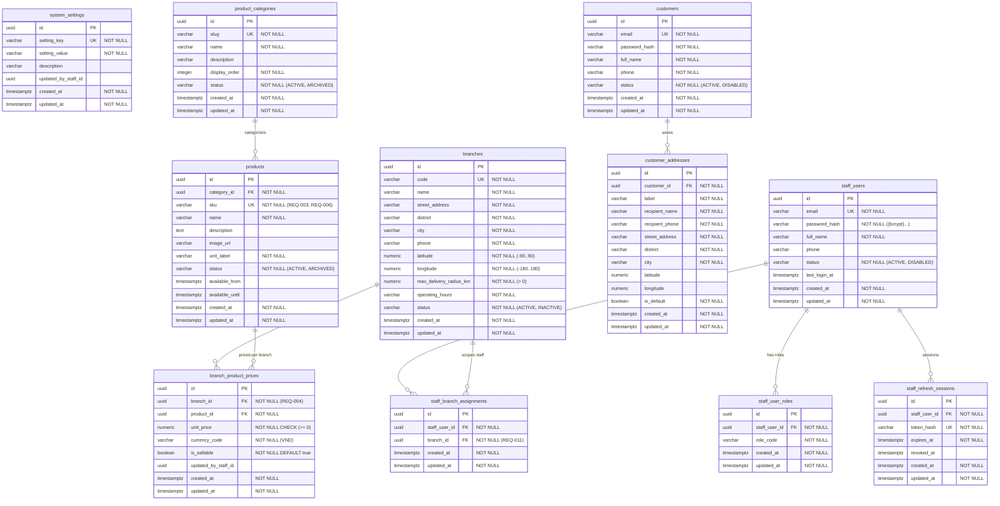

# Entity Evaluation and Entity-Relationship Diagrams (ERD)

- **Status:** PROPOSED (awaiting owner approval at Phase 5 gate before P07)
- **Last updated:** 2026-11-24
- **Owner:** database-engineer & solution-architect (`database-design` skill) · **Task:** TASK-012 (Phase 5 — P06 Database and API Design)
- **Sources:** `CLAUDE.md` §6, `ADR-0001`..`0010`, `docs/architecture/module-map.md`, `docs/requirements/functional-requirements.md` (`FR-001`..`038`), `non-functional-requirements.md` (`NFR-001`..`015`).

---

## 1. Evaluation of Candidate Database Entities

Per the P06 brief (*"Adjust the model to the approved requirements. Do not create tables merely because they appear in this illustrative list"*), all 20 candidate entity areas were evaluated against `REQ-001`..`017`, `FR-001`..`038`, and `module-map.md`:

| # | Candidate Area | Table Decision | Owning Module | Rationale & Requirement Traceability |
|---|---|---|---|---|
| 1 | **Users (Staff)** | **`staff_users`** | `identity` | Stores internal employee accounts, email, `bcrypt` password hash (`DelegatingPasswordEncoder`), and `status` (`FR-001`, `FR-003`, `FR-004`). Separated from `customers` so staff auth and customer auth never share credential tables. |
| 2 | **Roles and Permissions** | **`staff_user_roles`** + **`staff_branch_assignments`** + **`staff_refresh_sessions`** | `identity` | Role codes (`SYSTEM_OWNER`, `HEAD_OFFICE_ADMIN`, `BRANCH_MANAGER`, `SALES_STAFF`, `INVENTORY_STAFF`, `DELIVERY_STAFF`) are fixed application enums mapped via `staff_user_roles`; branch scope is stored in `staff_branch_assignments` (`REQ-011`, `REQ-012`, `FR-005`, `FR-006`). No dynamic permission table is needed. |
| 3 | **Organizations and Branches** | **`branches`** + **`system_settings`** *(No separate `organizations` table)* | `branch` | FlowerChain serves **one single business owner** across 5–30 branches (`REQ-001`). A multi-tenant `organizations` table is unnecessary overhead; chain-level parameters live in `system_settings` (`FR-037`) and each store is a row in `branches` (`FR-007`..`009`). |
| 4 | **Employees** | Consolidated into **`staff_users`** + **`staff_branch_assignments`** | `identity` | Avoids a redundant 1:1 `employees` table while capturing full name, phone, status, roles, and branch assignments (`FR-004`, `FR-005`). |
| 5 | **Customers** | **`customers`** + **`customer_addresses`** | `customer` | Stores customer accounts (`FR-002`, `FR-031`) and saved delivery addresses (`BRULE-027`). |
| 6 | **Categories** | **`product_categories`** | `catalog` | Central catalog categories managed by Head Office (`REQ-003`, `FR-010`). |
| 7 | **Products & Variants** | **`products`** *(Variants represented as distinct SKUs; no separate `product_variants` table in MVP)* | `catalog` | Central products with unique `sku`, `name`, `category_id`, `status`, and optional seasonal window (`available_from`, `available_until`, `FR-010`, `FR-011`). Modeling size variants as distinct SKUs keeps branch inventory (`REQ-002`) and branch prices (`REQ-004`) strictly 1:1 with `product_id`. |
| 8 | **Branch Prices** | **`branch_product_prices`** | `catalog` | Per-branch product price (`unit_price numeric(19,2) NOT NULL CHECK (unit_price >= 0)`) and branch visibility flag (`is_sellable`, `REQ-004`, `REQ-017`, `FR-012`, `FR-013`). |
| 9 | **Suppliers** | Stored on **`goods_receipts`** (`supplier_name`, `supplier_reference`) *(No standalone `suppliers` master table in MVP)* | `inventory` | Per P04 `FR-020` (`B19`), branches record Goods Receipts (stock-in) directly into branch inventory (`REQ-016` no central warehouse). |
| 10 | **Purchase Orders** | **`goods_receipts`** + **`goods_receipt_lines`** *(No multi-step `purchase_orders` table in MVP)* | `inventory` | Captures branch stock-in documents and lines (`FR-020`) that feed `branch_inventories` and `inventory_movements` (`REQ-008`). |
| 11 | **Inventory** | **`branch_inventories`** + **`stock_adjustments`** | `inventory` | `branch_inventories` holds `branch_id NOT NULL`, `product_id NOT NULL`, `available_stock CHECK (>= 0)`, `reserved_stock CHECK (>= 0)`, and `version` (`REQ-002`, `REQ-007`, `REQ-016`, `FR-015`). `stock_adjustments` records spoilage/damage/stocktake documents (`FR-019`). |
| 12 | **Inventory Transactions** | **`inventory_movements`** | `inventory` | Immutable append-only audit ledger (`REQ-008`, `FR-016`) recording every stock change (`actor_id`, `created_at`, `reason_code`, `branch_id`, `product_id`, `quantity_delta`, `available_after`, `reserved_after`, `source_type`, `source_id`). |
| 13 | **Stock Reservations** | Tracked via **`branch_inventories.reserved_stock`** + **`inventory_movements`** (`ORDER_RESERVED` / `ORDER_CONFIRMED` / `ORDER_RELEASED`) + **`orders.reservation_expires_at`** | `inventory` & `order` | Avoids a redundant reservation join table because every order has a single `processing_branch_id` (`REQ-005`) and deterministic `order_lines` (`FR-017`, `FR-021`). |
| 14 | **Stock Transfers** | **`stock_transfers`** + **`stock_transfer_lines`** | `inventory` | Tracks inter-branch transfers (`source_branch_id NOT NULL`, `target_branch_id NOT NULL`, `CHECK (source_branch_id <> target_branch_id)`) and requested/dispatched/received line quantities (`REQ-015`, `FR-018`). |
| 15 | **Orders and Order Items** | **`orders`** + **`order_lines`** + **`order_status_history`** + **`order_returns`** | `order` | `orders` enforces `processing_branch_id NOT NULL` (`REQ-005`) and `fulfilment_type` (`DELIVERY` / `PICKUP`, `REQ-013`). `order_lines` stores immutable snapshots (`product_name_snapshot`, `sku_snapshot`, `unit_price_snapshot`, `REQ-006`). |
| 16 | **Payments and Refunds** | **`payments`** + **`payment_webhook_events`** + **`payment_refunds`** | `payment` | Enforces `UNIQUE (provider, provider_event_id)` on `payment_webhook_events` and `UNIQUE (provider, provider_transaction_id)` on `payments` (`REQ-009`, `REQ-010`, `FR-025`..`027`). |
| 17 | **Deliveries** | **`order_deliveries`** | `delivery` | Tracks delivery dispatch, assigned `DELIVERY_STAFF` / courier notes, delivery address coordinates, and pickup/delivery hand-over timestamps (`FR-028`, `FR-029`). |
| 18 | **Promotions** | **`promotions_vouchers`** *(Conditional migration — applied only if owner enables `B6` / `FR-032`)* | `promotion` | Documented as an optional migration (`V202611240900__create_promotions_vouchers.sql`) so core MVP schema stays lean unless `B6` includes vouchers. |
| 19 | **Notifications** | **`notifications`** | `notification` | Stores branch-scoped staff alerts and customer order notifications (`FR-033`). |
| 20 | **Audit Logs** | **`audit_logs`** + **`idempotency_records`** | `audit` & `shared` | `audit_logs` stores immutable logins, role/branch assignment changes, branch price changes, order status/reassignment changes, and refunds (`CLAUDE.md` §8, `FR-036`). `idempotency_records` deduplicates `Idempotency-Key` requests (`CLAUDE.md` §7, `NFR-004`). |

**Total Core MVP Tables:** **24 tables** (plus 1 conditional `promotions_vouchers` table if `B6` is enabled).

---

## 2. Complete Entity-Relationship Diagram (Mermaid ERD)

### 2.1 Foundation, Identity, Branch, Customer, and Catalog Schema

### 2.2 Inventory, Stock Transfers, Orders, Payments, Delivery, and Audit Schema

```mermaid
erDiagram
    branch_inventories {
        uuid id PK
        uuid branch_id FK "NOT NULL (REQ-002, REQ-016)"
        uuid product_id FK "NOT NULL"
        integer available_stock "NOT NULL CHECK (>= 0) (REQ-007)"
        integer reserved_stock "NOT NULL CHECK (>= 0)"
        bigint version "NOT NULL DEFAULT 0"
        timestamptz created_at "NOT NULL"
        timestamptz updated_at "NOT NULL"
    }

    inventory_movements {
        uuid id PK
        uuid branch_id FK "NOT NULL (REQ-008)"
        uuid product_id FK "NOT NULL"
        varchar reason_code "NOT NULL"
        integer quantity_delta "NOT NULL CHECK (<> 0)"
        integer available_after "NOT NULL CHECK (>= 0)"
        integer reserved_after "NOT NULL CHECK (>= 0)"
        varchar source_document_type "NOT NULL"
        uuid source_document_id "NOT NULL"
        uuid actor_id
        varchar actor_type "NOT NULL"
        varchar note
        timestamptz created_at "NOT NULL"
        timestamptz updated_at "NOT NULL"
    }

    goods_receipts {
        uuid id PK
        uuid branch_id FK "NOT NULL"
        varchar receipt_number UK "NOT NULL"
        varchar supplier_name "NOT NULL"
        varchar supplier_reference
        uuid received_by_staff_id FK "NOT NULL"
        varchar note
        timestamptz received_at "NOT NULL"
        timestamptz created_at "NOT NULL"
        timestamptz updated_at "NOT NULL"
    }

    goods_receipt_lines {
        uuid id PK
        uuid goods_receipt_id FK "NOT NULL"
        uuid product_id FK "NOT NULL"
        integer received_quantity "NOT NULL CHECK (> 0)"
        timestamptz created_at "NOT NULL"
        timestamptz updated_at "NOT NULL"
    }

    stock_adjustments {
        uuid id PK
        uuid branch_id FK "NOT NULL"
        uuid product_id FK "NOT NULL"
        varchar adjustment_type "NOT NULL (SPOILAGE, DAMAGED, STOCKTAKE)"
        integer quantity_delta "NOT NULL CHECK (<> 0)"
        varchar reason_note "NOT NULL"
        uuid recorded_by_staff_id FK "NOT NULL"
        timestamptz created_at "NOT NULL"
        timestamptz updated_at "NOT NULL"
    }

    stock_transfers {
        uuid id PK
        varchar transfer_number UK "NOT NULL"
        uuid source_branch_id FK "NOT NULL (REQ-015)"
        uuid target_branch_id FK "NOT NULL (CHECK <> source)"
        varchar status "NOT NULL"
        uuid requested_by_staff_id FK "NOT NULL"
        uuid approved_by_staff_id FK
        uuid dispatched_by_staff_id FK
        uuid received_by_staff_id FK
        varchar note
        timestamptz dispatched_at
        timestamptz received_at
        timestamptz created_at "NOT NULL"
        timestamptz updated_at "NOT NULL"
    }

    stock_transfer_lines {
        uuid id PK
        uuid stock_transfer_id FK "NOT NULL"
        uuid product_id FK "NOT NULL"
        integer requested_quantity "NOT NULL CHECK (> 0)"
        integer dispatched_quantity "CHECK (>= 0)"
        integer received_quantity "CHECK (>= 0)"
        varchar discrepancy_note
        timestamptz created_at "NOT NULL"
        timestamptz updated_at "NOT NULL"
    }

    orders {
        uuid id PK
        varchar order_number UK "NOT NULL"
        uuid customer_id FK "NOT NULL"
        uuid processing_branch_id FK "NOT NULL (REQ-005, REQ-014)"
        varchar fulfilment_type "NOT NULL (DELIVERY, PICKUP) (REQ-013)"
        varchar status "NOT NULL"
        varchar payment_status "NOT NULL"
        varchar currency_code "NOT NULL (VND)"
        numeric items_subtotal "NOT NULL CHECK (>= 0)"
        numeric delivery_fee "NOT NULL CHECK (>= 0)"
        numeric discount_amount "NOT NULL CHECK (>= 0)"
        numeric total_amount "NOT NULL CHECK (>= 0)"
        varchar recipient_name "NOT NULL"
        varchar recipient_phone "NOT NULL"
        varchar delivery_street_address
        varchar delivery_district
        varchar delivery_city
        numeric delivery_latitude
        numeric delivery_longitude
        timestamptz requested_slot_start
        timestamptz requested_slot_end
        timestamptz reservation_expires_at
        varchar cancellation_reason
        timestamptz created_at "NOT NULL"
        timestamptz updated_at "NOT NULL"
    }

    order_lines {
        uuid id PK
        uuid order_id FK "NOT NULL"
        uuid product_id FK "NOT NULL"
        varchar sku_snapshot "NOT NULL (REQ-006)"
        varchar product_name_snapshot "NOT NULL (REQ-006)"
        numeric unit_price_snapshot "NOT NULL CHECK (>= 0) (REQ-006)"
        integer quantity "NOT NULL CHECK (> 0)"
        numeric line_total_snapshot "NOT NULL CHECK (>= 0)"
        timestamptz created_at "NOT NULL"
        timestamptz updated_at "NOT NULL"
    }

    order_status_history {
        uuid id PK
        uuid order_id FK "NOT NULL"
        varchar from_status
        varchar to_status "NOT NULL"
        uuid previous_branch_id FK
        uuid new_branch_id FK
        uuid actor_id
        varchar actor_type "NOT NULL"
        varchar reason_note
        timestamptz created_at "NOT NULL"
        timestamptz updated_at "NOT NULL"
    }

    order_deliveries {
        uuid id PK
        uuid order_id FK "UK NOT NULL"
        uuid branch_id FK "NOT NULL"
        varchar fulfilment_type "NOT NULL (DELIVERY, PICKUP)"
        uuid assigned_delivery_staff_id FK
        varchar courier_name
        varchar tracking_reference
        varchar handover_note
        timestamptz dispatched_at
        timestamptz completed_at
        timestamptz created_at "NOT NULL"
        timestamptz updated_at "NOT NULL"
    }

    order_returns {
        uuid id PK
        uuid order_id FK "NOT NULL"
        uuid branch_id FK "NOT NULL"
        varchar status "NOT NULL (REQUESTED, APPROVED_REFUND, APPROVED_REPLACEMENT, REJECTED)"
        varchar customer_reason "NOT NULL"
        varchar resolution_note
        boolean restocked "NOT NULL DEFAULT false"
        uuid reviewed_by_staff_id FK
        timestamptz created_at "NOT NULL"
        timestamptz updated_at "NOT NULL"
    }

    payments {
        uuid id PK
        uuid order_id FK "NOT NULL"
        varchar provider "NOT NULL"
        varchar payment_method "NOT NULL"
        varchar provider_transaction_id "UNIQUE with provider (REQ-010)"
        varchar status "NOT NULL (INITIATED, CAPTURED, FAILED, REFUNDED)"
        numeric amount "NOT NULL CHECK (>= 0)"
        varchar currency_code "NOT NULL (VND)"
        timestamptz captured_at
        timestamptz created_at "NOT NULL"
        timestamptz updated_at "NOT NULL"
    }

    payment_webhook_events {
        uuid id PK
        varchar provider "NOT NULL"
        varchar provider_event_id "NOT NULL UNIQUE with provider (REQ-010)"
        varchar provider_transaction_id
        uuid order_id FK
        boolean signature_verified "NOT NULL CHECK (true) (REQ-009)"
        varchar processing_Outcome "NOT NULL"
        timestamptz received_at "NOT NULL"
        timestamptz created_at "NOT NULL"
        timestamptz updated_at "NOT NULL"
    }

    payment_refunds {
        uuid id PK
        uuid payment_id FK "NOT NULL"
        uuid order_id FK "NOT NULL"
        numeric refund_amount "NOT NULL CHECK (> 0)"
        varchar reason "NOT NULL"
        varchar external_refund_ref
        uuid approved_by_staff_id FK "NOT NULL"
        timestamptz refunded_at "NOT NULL"
        timestamptz created_at "NOT NULL"
        timestamptz updated_at "NOT NULL"
    }

    audit_logs {
        uuid id PK
        varchar category "NOT NULL (LOGIN, ROLE_CHANGE, PRICE_CHANGE, ORDER_STATUS, REFUND, SETTING)"
        varchar action "NOT NULL"
        uuid branch_id FK
        varchar target_entity_type "NOT NULL"
        uuid target_entity_id
        uuid actor_id
        varchar actor_type "NOT NULL"
        jsonb old_values
        jsonb new_values
        varchar ip_address
        timestamptz created_at "NOT NULL"
        timestamptz updated_at "NOT NULL"
    }

    goods_receipts ||--|{ goods_receipt_lines : "contains"
    stock_transfers ||--|{ stock_transfer_lines : "contains"
    orders ||--|{ order_lines : "snapshots (REQ-006)"
    orders ||--|{ order_status_history : "tracks"
    orders ||--|| order_deliveries : "fulfilled via"
    orders ||--o{ order_returns : "returns"
    orders ||--o{ payments : "paid by"
    payments ||--o{ payment_refunds : "refunded by"
```

