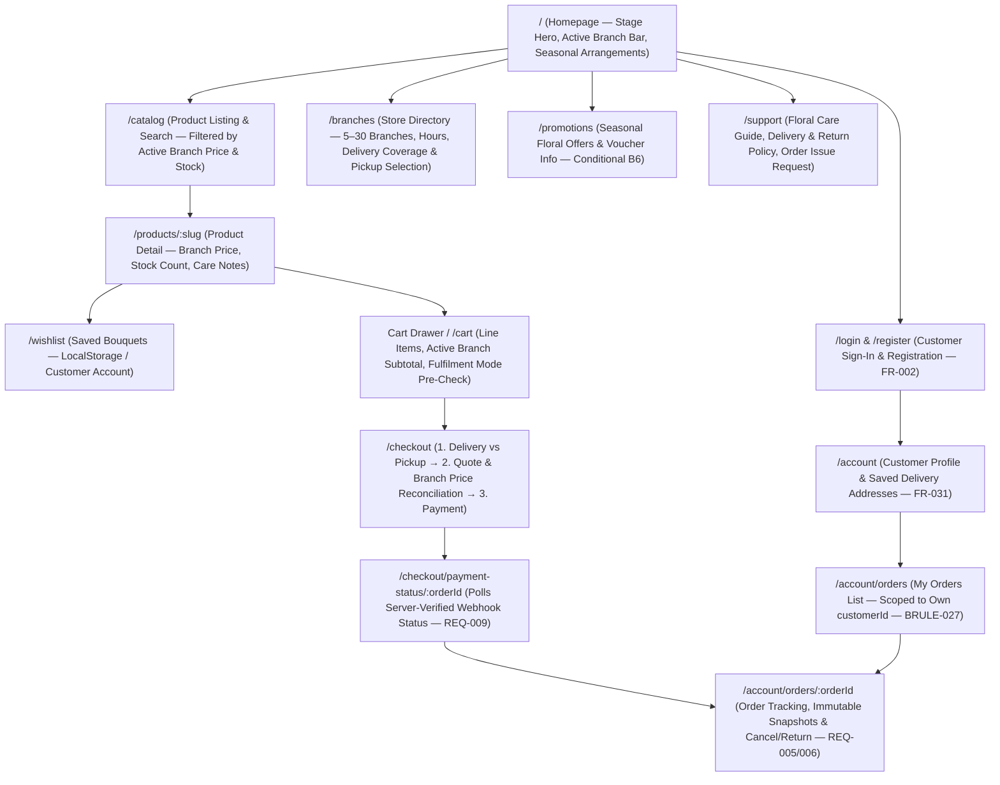
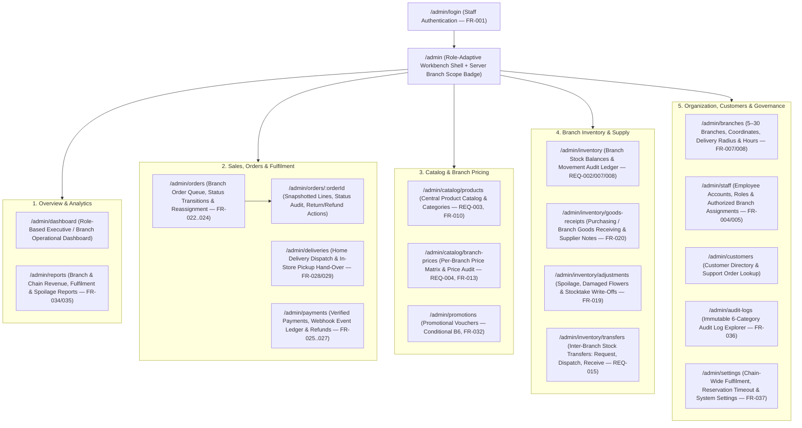
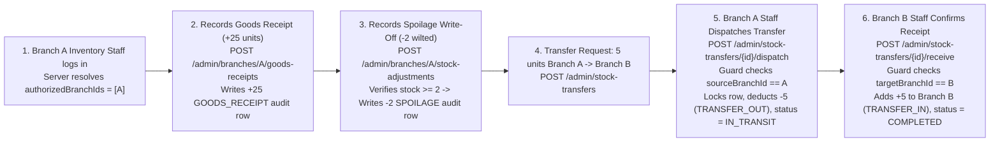

# Information Architecture, Sitemaps, and User Journeys

- **Status:** PROPOSED (awaiting owner approval at Phase 6 gate before P08)
- **Last updated:** 2026-11-24
- **Owner:** frontend-developer & business-analyst · **Task:** TASK-013 (Phase 6 — P07 UI/UX Design)
- **Sources:** P03 `business-process-maps.md` (`WF-01`..`12`), P04 `functional-requirements.md` (`FR-001`..`038`), `roles-and-permissions.md`, P06 `openapi.yaml`.

---

## 1. Dual-Application Information Architecture

Per `ADR-0001` (`DEC-005`) and `NFR-002`, FlowerChain is built as **two physically separate React + TypeScript + Vite applications** sharing `frontend/packages/shared`:

1. **Customer E-Commerce Website (`frontend/storefront`)** — Served at `/` for customers. Focused on editorial floral discovery, transparent per-branch pricing (`REQ-004`, `REQ-017`), frictionless delivery/pickup checkout (`REQ-013`, `REQ-014`), and order tracking (`REQ-005`, `REQ-006`).
2. **Internal Management Dashboard (`frontend/admin`)** — Served at `/admin` for Head Office and branch staff. Focused on high-density operational clarity, strict branch-scoped workflows (`REQ-011`, `REQ-012`), non-negative stock control (`REQ-007`), and full auditability (`REQ-008`).

---

## 2. Sitemaps

### 2.1 Customer Storefront Sitemap (`frontend/storefront`)

### 2.2 Internal Management Dashboard Sitemap (`frontend/admin`)

---

## 3. Navigation & Role-Based Dashboard Adaptation

> **Security Rule (`CLAUDE.md` §8, `.claude/agents/frontend-developer.md`):** Hiding a navigation link or button in the UI is a usability convenience, **never** a security boundary. Every API call enforces role and `BranchAuthorizationGuard` checks on the server (`REQ-011`, `REQ-012`).

| Role | Default Landing View (`/admin/dashboard`) | Visible Navigation Sections | Branch Selector Behavior in Top Bar |
|---|---|---|---|
| **`SYSTEM_OWNER` / `HEAD_OFFICE_ADMIN`** | **Chain Executive Dashboard:** Chain-wide revenue (`REQ-006`), active orders by branch (`REQ-005`), low-stock/spoilage alerts across all 5–30 branches, pending inter-branch transfers (`REQ-015`), and recent security/price/refund audit logs (`FR-036`). | All 5 sections (Overview, Sales/Fulfilment, Central Catalog & Branch Prices, Inventory/Transfers, Branches/Staff/Audit/Settings). | Global selector: `All Branches (Chain-Wide)` or filter by any specific branch. |
| **`BRANCH_MANAGER`** | **Branch Operations Dashboard:** Assigned branch's incoming order queue (`CONFIRMED`, `PREPARING`), today's pickup & delivery hand-overs, low-stock SKUs at their branch, active transfers involving their branch, and branch revenue summary. | Overview (own branch), Orders & Deliveries (own branch), Catalog (read-only) & Branch Prices (own branch), Inventory/Receipts/Spoilage/Transfers (own branch), Audit Logs (own branch operational logs). | Locked to assigned `authorizedBranchIds` (dropdown only if manager oversees >1 branch). |
| **`SALES_STAFF`** | **Branch Florist & Order Queue:** Live preparation queue (`CONFIRMED → PREPARING → READY_FOR_PICKUP / READY_FOR_DELIVERY`) and in-store pickup hand-over screen for their assigned branch. | Branch Orders, Pickup/Delivery Queue, Branch Stock Balances (read-only), Central Catalog (read-only), Walk-in POS (if `B1` Option A enabled). | Locked badge showing assigned branch name. |
| **`INVENTORY_STAFF`** | **Branch Stock & Transfer Workbench:** Current branch stock balances, quick Goods Receipt (stock-in) action, Spoilage/Damage write-off form, and incoming/outgoing Stock Transfers for their branch. | Branch Inventory & Movement Ledger, Goods Receipts, Spoilage/Adjustments, Stock Transfers, Central Catalog (read-only). | Locked badge showing assigned branch name. |
| **`DELIVERY_STAFF`** | **Branch Delivery Dispatch Queue:** Orders at their assigned branch in `READY_FOR_DELIVERY` and `OUT_FOR_DELIVERY` with recipient phone, address map link, and `Mark Out for Delivery` / `Complete Delivery` actions. | Delivery Queue (own branch). | Locked badge showing assigned branch name. |

---

## 4. Core End-to-End User Journeys (Mermaid Flows)

### 4.1 Journey 1: Customer Browsing, Branch Price Reconciliation & Checkout (`REQ-004`, `REQ-005`, `REQ-006`, `REQ-013`, `REQ-014`, `REQ-017`)

```mermaid
flowchart LR
    A["1. Customer opens Storefront<br/>Browsing Branch defaults to District 1<br/>(or customer picks nearest branch)"] --> B["2. Views Red Rose Bouquet<br/>Shows District 1 price: 500,000 VND<br/>& District 1 stock: 6 available"]
    B --> C["3. Adds 2 bouquets to Cart<br/>Opens /checkout"]
    C --> D{"4. Chooses Fulfilment<br/>(REQ-013)"}
    D -->|"In-Store Pickup (B3c)"| E["5a. Picks Pickup Branch with stock >= 2<br/>processingBranch = Pickup Branch<br/>Price = Pickup Branch Price"]
    D -->|"Home Delivery (REQ-014)"| F["5b. Enters Delivery Address<br/>Calls POST /storefront/orders/quote<br/>(Backend ignores client branchId - REQ-012)"]
    F --> G{"6. Nearest branch with stock<br/>has different price? (B11)"}
    G -->|"No (Same branch/price)"| H["7. Quote confirmed<br/>Items: 1,000,000 + Fee: 40,000"]
    G -->|"Yes (Allocated Branch B = 520,000)"| I["6b. CheckoutPriceReconciliationNotice<br/>Highlights updated Branch B price<br/>Customer checks confirmation box"]
    E --> H
    I --> H
    H --> J["8. POST /storefront/orders<br/>(with Idempotency-Key)<br/>Reserves stock (-2) & snapshots prices"]
    J --> K["9. Online Payment -> Polls<br/>Server-Verified Webhook Status (REQ-009)"]
    K --> L["10. Order Confirmed & Tracked<br/>Shows Processing Branch & Immutable Snapshots"]
```

### 4.2 Journey 2: Branch Inventory Lifecycle — Goods Receipt, Spoilage & Dual-Side Inter-Branch Transfer (`REQ-002`, `REQ-007`, `REQ-008`, `REQ-011`, `REQ-015`)

---

## 5. Standard UX State Specifications (Empty, Loading, Error, Validation & Accessibility)

### 5.1 Loading States
- Use warm oat hairline skeleton blocks (`background: var(--color-paper-2)`) matching the exact geometry of the target table rows or product grid so Cumulative Layout Shift (`CLS`) is `0.00`.
- Action buttons in flight show a disabled state (`aria-busy="true"`) with an inline label (`Placing order…`, `Dispatching transfer…`) and keep the active `Idempotency-Key` in memory until the response returns (`NFR-004`).

### 5.2 Empty States
- Never use cartoon illustrations or emojis (`Hallmark Floor #11`, `80`).
- Every empty state uses a calm `1px solid var(--color-rule)` well on `--color-paper-2` with:
  1. A concrete sentence-case heading naming what is empty (e.g., `No orders awaiting preparation at District 1 Branch`).
  2. One plain sentence explaining why or what appears here.
  3. One relevant action pill where applicable (e.g., `Record goods receipt` on an empty branch inventory table, or `Browse all active branches` when a product is out of stock at the current branch).

### 5.3 Error States (RFC 9457 Problem Details — `NFR-008`)
- Every API error (`400`, `401`, `403`, `404`, `409`, `422`, `500`) is parsed as `application/problem+json`:
  - **`400 VALIDATION_FAILED`:** Maps each key in `problem.errors` directly beneath the matching `<input>` field (`aria-invalid="true"`, `aria-describedby="<field>-error"`).
  - **`403 BRANCH_ACCESS_DENIED` (`REQ-011`, `REQ-012`):** Displays a clear boundary notice: *"You are authorized for [Branch A] only. This resource belongs to another branch."* with a button to return to the user's authorized branch scope.
  - **`409 INVENTORY_INSUFFICIENT_STOCK` (`REQ-007`):** Displays the exact current `availableStock` at the branch so the customer or staff member can adjust the quantity immediately.
  - **`409 ORDER_PRICE_CHANGED` (`B11`):** Triggers the `CheckoutPriceReconciliationNotice` component with updated branch prices.
  - **`422 DELIVERY_OUT_OF_RANGE` (`REQ-014`):** Offers a one-click switch to **In-Store Pickup** at the nearest active branch.

### 5.4 Accessibility (`NFR-013`, Hallmark Floor #6 & #7)
- **Keyboard & Focus:** Skip-to-main-content link is the first focusable element; `:focus-visible` renders an instant `2px solid var(--color-focus)` outline with `2px` offset (`transition: none` on outline).
- **Semantics & Labels:** Every form control has a visible `<label>`, tables use `<th scope="col">`, status changes announce via `aria-live="polite"`, and heading levels step sequentially (`h1 → h2 → h3`).
- **Contrast & Reduced Motion:** Forest green ink (`oklch(23% 0.050 152)`) on warm oat paper (`oklch(95.8% 0.024 90)`) provides **> 12.5:1 WCAG AAA contrast**. Under `@media (prefers-reduced-motion: reduce)`, all transitions and hover transforms rest immediately.
